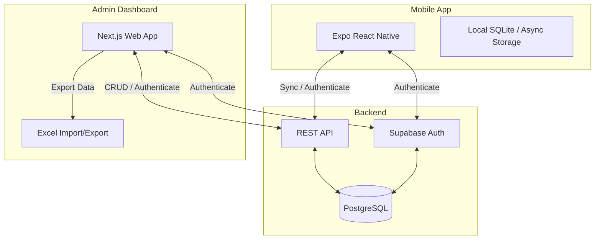

# Entry Book

## Overview
Entry Book is a full-stack mobile data entry application paired with an admin dashboard. It enables field workers or operators to easily record data entries (such as product sales, expenses, or inventory logs) via a mobile application, while providing administrators with a web-based dashboard for viewing, filtering, and exporting this data to Excel. The system features offline support in the mobile app, secure authentication, and robust data validation.

## Architecture


## Tech Stack
| Component | Technology | Description |
|-----------|------------|-------------|
| Mobile App | React Native, Expo | Cross-platform mobile framework |
| Admin Web | Next.js (App Router), React, Tailwind CSS | Web dashboard frontend |
| Backend | Supabase, PostgreSQL | Database, Auth, API |
| Shared | TypeScript, Jest | Shared types and validation |
| Build & Deploy | EAS CLI, Vercel | Mobile builds and web hosting |

## Project Structure  
```
entry-book/
├── admin/               # Next.js Admin Dashboard
├── mobile/              # Expo React Native App
├── shared/              # Shared Types and Validation Logic
│   ├── types/           # Interfaces and type definitions
│   ├── validation/      # Zod or custom validation functions
│   ├── __tests__/       # Shared logic tests
│   └── package.json     
├── package.json         # Root package manager commands
└── README.md            # Project documentation
```

## Prerequisites
- Node.js 18+
- npm or yarn
- Expo CLI
- EAS CLI (for mobile builds)
- Supabase account and project
- Android phone or emulator (for mobile testing)

## Supabase Setup
1. **Create Supabase project**: Go to [Supabase](https://supabase.com/) and create a new project.
2. **Run migration SQL**: In the Supabase SQL Editor, execute the schema definitions to create tables (`entries`, `profiles`, etc.) and Row Level Security (RLS) policies.
3. **Create admin user**: Sign up a user through the dashboard or auth endpoint. Set their role in the `profiles` table to 'admin'.
4. **Run seed SQL**: Optional. Add some initial test data to the tables.
5. **Configure env vars**: Obtain your Project URL and anon key from the API Settings.

## Environment Variables
Create a `.env` file in both `mobile/` and `admin/` directories.

| Variable | Description |
|----------|-------------|
| `EXPO_PUBLIC_SUPABASE_URL` / `NEXT_PUBLIC_SUPABASE_URL` | The REST URL for your Supabase project API. |
| `EXPO_PUBLIC_SUPABASE_ANON_KEY` / `NEXT_PUBLIC_SUPABASE_ANON_KEY` | The public anonymous key for Supabase API access. |

## Installation
Run the following from the root of the repository to install dependencies for all workspaces:
```bash
npm run install:all
```

## Running the Mobile App
```bash
cd mobile
npx expo start
```
Scan the QR code with your phone (using Expo Go) or press `a` to open in an Android emulator.

## Running the Admin Dashboard
```bash
cd admin
npm run dev
```
Open `http://localhost:3000` in your web browser.

## Creating an Admin User
1. Register a new user either through the mobile app or the admin dashboard login page.
2. Open your Supabase Dashboard -> Table Editor -> `profiles`.
3. Locate the user you just created and change their `role` column from `user` to `admin`.
4. The user will now have full access to the Admin Dashboard.

## Database Schema
| Table | Column | Type | Description |
|-------|--------|------|-------------|
| `entries` | `id` | UUID | Primary Key |
| | `name` | Text | Name of the person/entity |
| | `entry_date` | Date | Date of the entry |
| | `product` | Text | Product description |
| | `quantity` | Numeric | Quantity |
| | `price` | Numeric | Unit price |
| | `discount_percent` | Numeric | Discount percentage (0-100) |
| | `subtotal` | Numeric | Calculated subtotal |
| | `discount_amount`| Numeric | Calculated discount amount |
| | `final_amount` | Numeric | Calculated total after discount |
| | `created_by` | UUID | Reference to auth.users |
| `profiles` | `id` | UUID | Primary Key (matches auth.users.id) |
| | `role` | Text | 'admin' or 'user' |
| | `email` | Text | User's email |

## Excel Export
Administrators can export data to Excel via the Admin Dashboard. 
- **How it works**: The app queries the entries based on active filters, formats the data, and generates a `.xlsx` file using the `xlsx` library.
- **Columns**: ID, Name, Date, Product, Quantity, Price, Discount (%), Subtotal, Discount Amount, Final Amount, Created At.
- **Formatting**: Currency fields are properly formatted, and dates use standard readable formats.

## Excel Import
Administrators can also bulk import entries via Excel.
- **Required Columns**: Name, Date, Product, Quantity, Price. Optional: Discount (%).
- **Validation**: Dates must be valid (YYYY-MM-DD or MM/DD/YYYY). Quantity and Price must be positive numbers. Discount must be between 0 and 100.
- **Process**: Upload the file -> Preview parsed valid and invalid rows -> Fix errors if any -> Commit valid rows to Supabase.

## Building Android APK
To build a standalone Android application (`.apk`):
```bash
npm install -g eas-cli
cd mobile
eas login
eas build --platform android --profile preview
```
Once the build is complete, EAS CLI will provide a link to download the `.apk` file directly to your device or emulator.

## Deploying Admin Dashboard
The easiest way to deploy the Next.js Admin Dashboard is via [Vercel](https://vercel.com/):
1. Push your code to a GitHub/GitLab/Bitbucket repository.
2. Import the project in Vercel.
3. Set the Root Directory to `admin/`.
4. Add the `NEXT_PUBLIC_SUPABASE_URL` and `NEXT_PUBLIC_SUPABASE_ANON_KEY` Environment Variables.
5. Click Deploy.

## Security
- **Row Level Security (RLS)**: PostgreSQL RLS policies ensure that regular 'users' can only select/insert/update their own entries, while 'admins' can view and manage all entries.
- **Authentication**: All API requests require a valid Supabase JWT token.
- **Env Vars**: Never commit your Supabase Service Role Key; only expose the Anon Key to the frontend.

## API Endpoints
The application relies on Supabase's auto-generated REST API (PostgREST) rather than custom endpoints. The SDK handles database interactions via `supabase.from('table_name').select()`.

## Troubleshooting
- **Network Errors on Mobile**: Ensure your phone/emulator and development machine are on the same local network. If using an emulator, `localhost` points to the emulator itself, not your PC; Expo automatically handles routing.
- **Missing Data**: Check if your Supabase RLS policies are too restrictive or if the user is not properly authenticated.
- **Build Failures**: If EAS build fails, verify your `app.json` configuration and ensure you have valid Android keystores.
